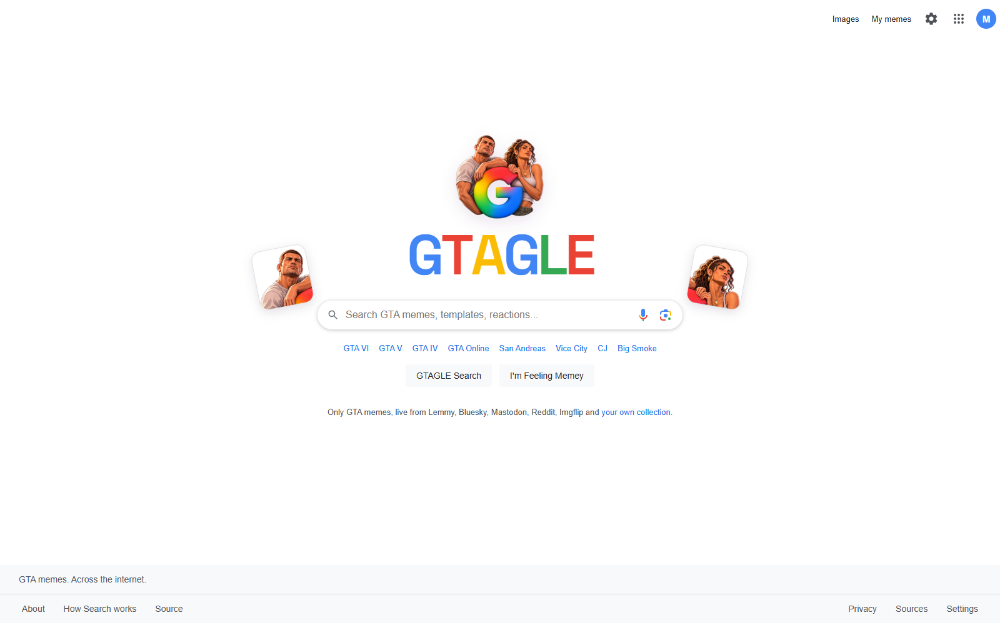

<div align="center">

# GTAGLE

### GTA memes. One search away.

Discover memes across the GTA universe, explore multiple sources, and keep your favorites in one place.

[Explore the site](https://gtagle.online) · [Run locally](#run-locally) · [How it works](#how-it-works)

</div>



## Your next GTA meme starts here

GTAGLE brings a familiar search experience to Grand Theft Auto meme culture. Find San Andreas classics, explore Vice City reactions, or discover content around GTA VI without repeating the same search across every platform.

- **Search across sources.** Reddit, Lemmy, Bluesky, Mastodon and Imgflip in one interface.
- **Explore GTA.** Games, characters, locations and memorable phrases, with quick topic shortcuts.
- **Browse your way.** All, Images, GIFs, Templates and My memes, plus source filters and sorting.
- **Save your favorites.** A personal browser collection with organization and export tools.
- **Use any screen.** Responsive search and image previews for desktop and mobile.

## Run locally

Requires Node.js. No dependency installation or build step.

```sh
node tools/serve.cjs
```

Open **http://127.0.0.1:8000**. For another port, run `node tools/serve.cjs 8080`.

## How it works

A static HTML, CSS and JavaScript application. Source requests run in the browser. GTA aliases and shared metadata/community filters focus the results; this is text-based filtering, not image recognition.

Live results depend on third-party API availability and browser restrictions. Tenor, Giphy and Imgur require optional user API keys in Settings. Local GTA meme cards remain available while external services load or are unavailable.

Collections and settings use IndexedDB and localStorage. Existing storage keys are preserved to retain saved collections. There is no GTAGLE account server. Queries are sent to selected sources; optional suggestions use Google's suggestion endpoint.

## Deploy

Deploy the repository root as a static site. `vercel.json` handles direct visits and refreshes for `/search`, `/settings`, `/tags`, `/folders` and `/upload`. Other hosts need equivalent SPA route handling. Missing assets should return 404.

## Project structure

| Path | Purpose |
| --- | --- |
| `index.html` | Entry point and metadata |
| `js/app.js` | Routing, search UI, previews and collection actions |
| `js/gta.js` | GTA topics, aliases and subject filtering |
| `js/sources.js` | Public-source adapters and result sessions |
| `js/store.js` | Browser storage and collections |
| `css/google.css` | Original Memegle search layout |
| `css/google-gta.css` | Branding and responsive adjustments |
| `assets/gta/` | Artwork, icons and local meme assets |
| `tools/serve.cjs` | Dependency-free local server |

## Credits and license

Built on [Memegle](https://github.com/justbuildsstuff/Memegle), with GTA-focused discovery and custom artwork.

See [LICENSE](LICENSE) and [NOTICE](NOTICE); retain both when redistributing. Third-party content belongs to its respective owners. Original source links are preserved with results and in `data/memes.json`.

GTAGLE is an independent fan project, unaffiliated with Google, Rockstar Games or the source platforms.
